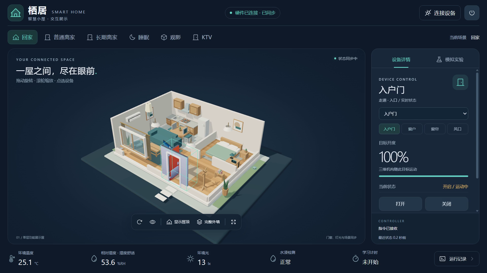
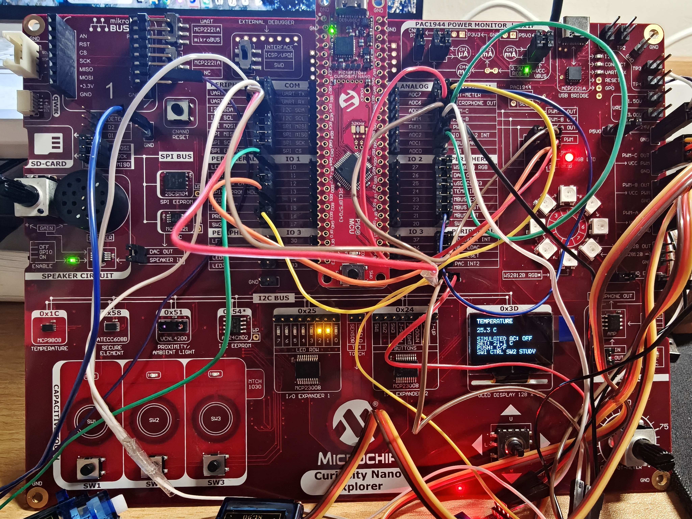

# 智慧小屋 · Smart Home PIC18

基于 PIC18F57Q43 Curiosity Nano 和 Curiosity Nano Explorer 的课程原型。板端采集温湿度、照度、雨滴、水浸等输入，并执行场景联动。桌面上位机通过 SH1 串口协议控制和查看状态，也能在不连接板卡时独立运行 3D 模拟。

| 目录 | 内容 |
| --- | --- |
| [SmartHomeHost](SmartHomeHost) | Python / Qt WebEngine 上位机、React / Three.js 场景、离线模拟、[SH1 串口协议](SmartHomeHost/PROTOCOL.md)及测试 |
| [SmartHomeStuFull](SmartHomeStuFull) | 原创固件扩展、课程起始工程的集成改动、XC8 构建入口及原生 C 测试 |
| [BasicLabs](BasicLabs) | 基础实验 1–9 的自编代码索引、提取及阶段构建入口 |
| [media](media) | 上位机与硬件实拍、最终展示视频下载与来源说明 |



[观看或下载最终展示视频（4分55秒，1080p）](https://github.com/StEleven/smart-home-pic18/releases/tag/demo-v1.0)。视频包含实物拍摄、上位机录屏和功能示意动画，具体范围见 [media](media/README.md)。

## 硬件与功能

板端使用 MCP9808 温度、VCNL4200 照度/接近、外接 SHT30 温湿度及两路独立雨滴/水浸输入。四路舵机模拟门、窗、风口、窗帘；板载 LED、RGB 灯和 OLED 表示灯光、制冷与家电输出。六场景包括回家、普通离家、长期离家、睡眠、观影和 KTV，另有防雨、遮阳、水浸消音、学习计时及手动接管。



## 运行 3D 离线演示

在 Windows 上安装 64 位 Python 和 Node.js（验证版本：Python 3.14.3、Node.js 24.14.1）。建议将仓库放在较短的目录，例如 `C:\src\smart-home-pic18`，便于在未开启长路径的系统上安装 PySide6。首次在 PowerShell 中运行：

```powershell
cd SmartHomeHost
./setup.ps1
./.venv/Scripts/python.exe run.py --demo
```

桌面端支持旋转、缩放、显示或隐藏屋顶与外墙，并可切换场景、控制模型设备、在离线模式下注入模拟输入。连接真实板卡时运行 `run.py`，在界面中选择对应 COM 口。门、窗、风口和窗帘用舵机模拟，3D 动作表示控制输出；门窗位置没有独立的物理反馈。

## 构建板端固件

按[固件说明](SmartHomeStuFull/README.md)准备本地课程起始工程 `SmartHomeFrame.zip` 和 Microchip XC8。[基础实验入口](BasicLabs/README.md)按阶段导航至同一份自编集成代码，避免维护重复源码。公开固件构建使用合成提示音，上位机离线演示不依赖课程包。

仓库只收录项目实际运行所需的原创实现、必要说明、测试及许可允许的资源。教师课件、任务书、课程框架原件、实验报告、原始录音和本地制作缓存均不发布。课程框架和厂商文件须由使用者自行取得，并适用原有条款。

## 许可

项目原创代码、集成改动和文档按 [MIT](LICENSE) 发布。模型、纹理及场景实现的第三方来源见 [第三方声明](SmartHomeHost/third_party/README.md)。本地课程工程和 Microchip 工具链适用其自身条款。
